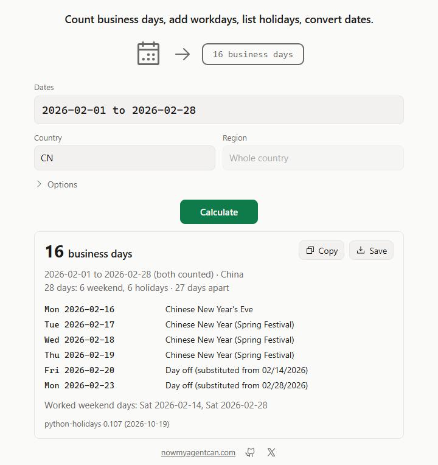

# date-calc

Count business days and hours with official public holidays for 250 countries, add working days, list holidays, and convert dates between six calendars. Offline, in one small binary.



## Install

Windows (PowerShell, no admin; installs to `%LOCALAPPDATA%\Programs\date-calc` and adds it to your user PATH):

```powershell
irm https://github.com/nowmyagentcan/date-calc/releases/latest/download/install.ps1 | iex
```

macOS and Linux (installs to `~/.local/bin`):

```sh
curl -fsSL https://github.com/nowmyagentcan/date-calc/releases/latest/download/install.sh | sh
```

Both scripts check the archive's SHA-256 against `SHA256SUMS` before installing anything. Or download an archive yourself; each holds one `date-calc` binary that needs no runtime:

| System | Download |
|---|---|
| Windows x64 | [date-calc-v0.1.0-windows-x64.zip](https://github.com/nowmyagentcan/date-calc/releases/download/v0.1.0/date-calc-v0.1.0-windows-x64.zip) |
| macOS Apple silicon | [date-calc-v0.1.0-macos-arm64.tar.gz](https://github.com/nowmyagentcan/date-calc/releases/download/v0.1.0/date-calc-v0.1.0-macos-arm64.tar.gz) |
| macOS Intel | [date-calc-v0.1.0-macos-x64.tar.gz](https://github.com/nowmyagentcan/date-calc/releases/download/v0.1.0/date-calc-v0.1.0-macos-x64.tar.gz) |
| Linux x64 (static) | [date-calc-v0.1.0-linux-x64.tar.gz](https://github.com/nowmyagentcan/date-calc/releases/download/v0.1.0/date-calc-v0.1.0-linux-x64.tar.gz) |
| Linux arm64 (static) | [date-calc-v0.1.0-linux-arm64.tar.gz](https://github.com/nowmyagentcan/date-calc/releases/download/v0.1.0/date-calc-v0.1.0-linux-arm64.tar.gz) |

With Rust: `cargo install --git https://github.com/nowmyagentcan/date-calc --tag v0.1.0 --locked`.
To remove it, delete the binary (on Windows, the `date-calc` folder above).

## Use

```sh
date-calc between 2026-02-01 2026-02-28 -c CN          # business days, both dates counted
date-calc between today 2026-12-31 -c DE-BY --exclude-start
date-calc add 2026-11-02 10 -c US                       # 10 business days later
date-calc add 2026-01-31 1 -u months --roll modified-following -c GB-ENG
date-calc hours "2026-11-02 10:00" "2026-11-05 15:00" -c DE --hours 09:00-12:00,13:00-17:00
date-calc holidays DE 2026 -r BY                        # a year's holidays in Bavaria
date-calc convert 1 Ramadan 1448                        # the date in the other calendars
date-calc countries DE                                  # regions and weekend history
```

```text
$ date-calc between 2026-02-01 2026-02-28 -c CN
16 business days
2026-02-01 to 2026-02-28 (both counted) · China
28 days: 6 weekend, 6 holidays · 27 days apart
  Mon 2026-02-16  Chinese New Year's Eve
  Tue 2026-02-17  Chinese New Year (Spring Festival)
  Wed 2026-02-18  Chinese New Year (Spring Festival)
  Thu 2026-02-19  Chinese New Year (Spring Festival)
  Fri 2026-02-20  Day off (substituted from 02/14/2026)
  Mon 2026-02-23  Day off (substituted from 02/28/2026)
Worked weekend days: Sat 2026-02-14, Sat 2026-02-28
python-holidays 0.107 (2026-10-19)
```

```text
$ date-calc convert 2026-10-27 --to hebrew
Gregorian  Tue 2026-10-27 · week 2026-W44 · day 300
Hebrew     16 Cheshvan 5787
icu_calendar 2.4.0 · nepali-datetime 1.0.8.5 (2026-05-07)
```

- `-c` takes a code (`DE`, `DEU`), a name (`germany`) or `CC-REGION` (`DE-BY`); `-r` takes a region code or name (`BY`, `Bayern`). Without a country only weekends are skipped.
- `between` counts both dates, like a spreadsheet's NETWORKDAYS, and is negative when the end comes first. The same date twice answers "is this a business day?" (1 or 0).
- `add` counts business days like WORKDAY: the start isn't counted. `-u` also takes `days`, `weeks`, `months`, `years` and `business-hours`; `--roll` moves a calendar-unit result off a non-business day.
- `--weekend FRI,SAT` (day names, a mask from Monday like `0000110`, or `none`) replaces the country's weekend; `--tz Europe/Berlin` makes business hours count real elapsed time across clock changes.
- The first line of `between`, `add` and `hours` is the answer, so `$(date-calc add 2026-11-02 10 -c US | head -1)` works.
- Exit codes: 0 ok (warnings included), 1 invalid input or a date outside the data, 2 usage, 3 runtime.

Run `date-calc` alone for interactive mode: type `2026-11-02 +10`, `2026-11-02 11:00 +1.5 hours`, `2027` or `1 Ramadan 1448`, and set the session with `/country DE`, `/region BY`, `/tz`, `/hours`; `/quit` leaves.

**The page:** `date-calc ui` opens a small page in your browser, served on `127.0.0.1` only. Type a query in the same form, pick a country and region, and press Enter. Copy and Save give the answer as text.

### Use with AI agents

Agents can run the CLI with `--json` (one JSON object on stdout; errors as `{"error":{"code","message","hint"}}`):

```sh
date-calc between 2026-02-01 2026-02-28 -c CN --json
date-calc add 2026-11-02 10 -c US --json
date-calc convert 2026-10-27 --json
```

Or add the local MCP server (stdio, tools `business_days_between`, `add_to_date`, `business_hours_between`, `list_holidays`, `convert_date`, `list_countries`):

| Agent | Setup |
|---|---|
| Claude Code | `claude mcp add date-calc -- date-calc mcp` |
| Codex | `codex mcp add date-calc -- date-calc mcp` |
| Cursor (`~/.cursor/mcp.json`), Claude Desktop | `{"mcpServers":{"date-calc":{"command":"date-calc","args":["mcp"]}}}` |
| VS Code (`.vscode/mcp.json`) | `{"servers":{"date-calc":{"type":"stdio","command":"date-calc","args":["mcp"]}}}` |

Each tool returns the CLI's `--json` object as `structuredContent` and as text. Bad input returns `isError: true` with one text block holding the error object.

## Supported inputs and limits

- **Holidays:** the public holidays of python-holidays 0.107 for 250 countries and 626 regions, mostly 2000-2050 (`date-calc countries` lists each country's years: India 2001-2035, Sri Lanka 2003-2026). A date outside a country's years is an error, never a guess. Bank, optional, school and religious-group holidays, half days and market calendars aren't included.
- **Decree schedules:** for the 34 countries that announce one-off holidays or swapped workdays (China, Russia, Vietnam and others), the data is complete through the year `countries` shows as "decree data to"; later dates carry a warning.
- **Estimated dates:** Islamic and other lunar holidays that python-holidays marks as estimated are counted and flagged.
- **Dates:** `YYYY-MM-DD` from 0001 to 9999, or `today`. Date-times: `2026-11-02 09:30`, `2026-11-02T09:30`, an instant with `Z` or an offset (needs `--tz`), or `now`.
- **Working hours:** `09:00-17:00` by default; several windows (`09:00-12:00,13:00-17:00`), `24:00` as an end, and overnight windows, which belong to the day they start.
- **Time zones:** IANA names from the bundled tzdata 2026f, so every system gives the same answer.
- **Calendars:** Gregorian, Islamic Umm al-Qura (1300-1600 AH) and tabular, Hebrew, Chinese, Persian and Nepali Bikram Sambat (1975-2100 BS; from 2084 BS the table is projected and flagged). Read them as `1 Tishrei 5787`, or `5787-01-01 --from hebrew` with leap months as `05L`.
- **Known data limits:** python-holidays' weekends differ from Unicode CLDR for 17 countries (AF, AI, BD, BN, CD, DJ, HK, IN, KN, LY, MR, MV, NE, PY, TK, UG, VE); Nepal is Sat-Sun for every year, though it moved from Saturday only on 2026-04-06; tables disagree on the Baisakh/Jestha split of 2062 BS. `--weekend` overrides any weekend.
- It makes no network requests, and never updates itself; `ui` listens on 127.0.0.1 only.

## How it works

Holidays, regional differences, decree workdays and weekends by date come from [python-holidays](https://github.com/vacanza/holidays), exported at build time into a text file inside the binary; only the requested country is read.
Dates, spans and time zones use [jiff](https://github.com/BurntSushi/jiff) with the [IANA tz database](https://www.iana.org/time-zones) compiled in; Islamic, Hebrew, Chinese and Persian dates use [ICU4X](https://github.com/unicode-org/icu4x)'s `icu_calendar`, and Bikram Sambat the month table of [nepali-datetime](https://github.com/amitgaru2/nepali-datetime).
Every answer names its data versions, and a monthly check opens an issue when python-holidays, tzdata or the Bikram Sambat table has a newer release.

## First run on an unsigned build

Windows: if "Windows protected your PC" appears, choose More info, then Run anyway.
The install script doesn't trigger it; a zip extracted in Explorer may.

macOS: if it says the developer can't be verified, open System Settings, Privacy & Security, and choose Open Anyway.
The install script doesn't trigger it, because curl downloads carry no quarantine flag.

## Licence

Apache-2.0, see [LICENSE](LICENSE). Each release archive includes `THIRD-PARTY-LICENSES.txt` for the bundled dependencies and data (python-holidays, nepali-datetime, Phosphor Icons).

---

[nowmyagentcan.com](https://nowmyagentcan.com) · [x.com/chayp05](https://x.com/chayp05)
